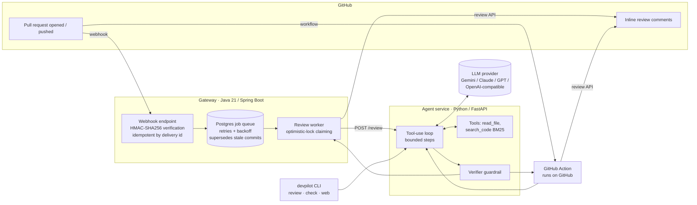

# DevPilot: AI Code Review Agent

DevPilot is an LLM agent that reviews code like a senior engineer. It reads the change,
**investigates the surrounding code with tools** (file reads, BM25 code search), and reports
specific, line-level problems: bugs, security holes, concurrency issues, broken error handling
and performance traps. Each problem comes with a concrete fix, and DevPilot can also write the
fixed version of the code for you to check.

It works with Gemini, Claude and GPT, and with self-hosted models through any OpenAI-compatible
API. It runs four ways:

| Mode | How you use it | Needs GitHub? |
|---|---|---|
| **Local mode** | `devpilot review` in any git repo; results print in your terminal. It can also run as a pre-push hook. | No |
| **Paste / single file** | `devpilot web` page or `devpilot check file.py --fix`: review any code and get a fixed version. | No |
| **GitHub Action** | Add one workflow file; GitHub runs DevPilot on every PR and it posts inline comments. | Yes, nothing to host |
| **Self-hosted server** | Spring Boot gateway receives webhooks, queues reviews and posts comments. | Yes |

Every comment passes through a **verifier guardrail** before you see it. The guardrail removes
hallucinated files, comments on lines the PR didn't touch, low-confidence guesses, duplicates and nits.

**Highlights**

- Found **10 of 11** planted bugs on a seeded-bug benchmark, against 3 of 11 for a regex baseline
  (recall 0.91, F1 0.83, Gemini Flash-Lite). See [Results](#results).
- **Live on GitHub:** this repo reviews its own pull requests and pushes. See
  [PR #1](https://github.com/yaswanth0702/devpilot-ai-code-reviewer/pull/1) for a real review.
- **Paste-and-fix:** caught all 3 bugs in a Java class and produced a minimal, correct fix
  ([example](docs/paste-review-example.md)).
- **Tested:** 40 Python tests and 8 Java tests run in CI on Python 3.10 and 3.12.

---

## Architecture



All entry points (CLI, paste page, GitHub Action, self-hosted gateway) share the same agent loop
and verifier, so a review behaves the same wherever it runs.

**Why two services in self-hosted mode?** The gateway handles the parts that need to be reliable: signature checks,
durable queueing, retries, idempotency and the GitHub API. The agent handles the parts that keep
changing: prompts, tools and model providers. Either one can be deployed or scaled on its own.

### Design decisions

- **Async webhook handling.** A review takes 30–90 seconds with a real LLM, but GitHub times out
  webhooks after 10 seconds. The endpoint therefore only verifies and enqueues the job, then
  returns `202 Accepted`. A worker does the review.
- **The database is the queue.** Jobs survive restarts. Several gateway instances can poll safely
  because a JPA `@Version` optimistic lock decides which instance claims a job. Failed jobs retry
  with exponential backoff up to `max-attempts`, then are marked `FAILED` with the error.
- **Idempotent and supersedes stale work.** Duplicate deliveries (same `X-GitHub-Delivery`) are
  ignored. A new push to a PR marks older queued reviews of that PR `SUPERSEDED`, so no model
  calls are spent on outdated commits.
- **Bounded agent.** The loop is capped at `max_steps`. On the last step only `submit_review` is
  offered, so a review always finishes. Malformed model output is dropped and never crashes a run.
- **Verifier guardrail.** The verifier applies hard rules after the model, and each dropped
  comment is recorded with its reason:
  - the file must be in the diff
  - the line must be added or modified (near misses within 2 lines are snapped onto the changed line)
  - confidence must meet the threshold
  - nits are filtered, along with duplicates and vague comments
  - at most 12 comments per review, ordered by severity
- **Human stays in charge.** Reviews are posted with `event: COMMENT`. DevPilot never approves
  or blocks a PR.
- **Provider-agnostic.** One internal message format, with adapters for Anthropic and for the
  OpenAI format. Gemini uses Google's OpenAI-compatible endpoint, and Gemini 3 *thought signatures*
  are carried through tool-call turns so multi-step reviews keep working. `OPENAI_BASE_URL` also
  works with Ollama or vLLM for self-hosted models.

---

## Quick start

Requirements: Python 3.10+ and git. You also need an API key: a Gemini key from
[Google AI Studio](https://aistudio.google.com/apikey) (it starts with `AIza`), an Anthropic key or
an OpenAI key.

**One step:**

```bash
git clone https://github.com/yaswanth0702/devpilot-ai-code-reviewer.git
cd devpilot-ai-code-reviewer
bash scripts/setup_and_run.sh gemini     # or anthropic / openai
```

This creates `agent/.venv`, installs DevPilot, runs the tests, asks for your API key (hidden,
never saved) and runs the benchmark.

**Every new Terminal window** needs the environment activated and the key set:

```bash
cd devpilot-ai-code-reviewer && source agent/.venv/bin/activate
export GEMINI_API_KEY=AIza...            # or ANTHROPIC_API_KEY / OPENAI_API_KEY
```

Tip: `export DEVPILOT_PROVIDER=gemini` makes Gemini the default, so you can leave out `--provider`
(the pre-push hook relies on this too). With `--provider gemini`, DevPilot uses `gemini-3.1-flash-lite` with minimal reasoning by
default. That's fast, and it's the setup the published benchmark used. Override it with
`DEVPILOT_MODEL` and `DEVPILOT_REASONING_EFFORT`.

### Review your changes in a git repo

```bash

cd ~/code/my-project
devpilot review --provider gemini                    # uncommitted changes
devpilot review --provider gemini --staged           # staged changes only
devpilot review --provider gemini --base main        # your branch vs main
devpilot review --provider gemini --base HEAD~3      # the last 3 commits
devpilot review --provider gemini --format json      # machine-readable
devpilot review --provider gemini --fail-on critical # exit 1 on critical issues (for hooks/CI)
```

No API key yet? Add `--provider mock` to run the full pipeline with an offline, rule-based stand-in
(see [Results](#results)).

**Pre-push hook.** This blocks a push when DevPilot finds a critical issue:

```bash
scripts/install-pre-push-hook.sh ~/code/my-project
```

Example output: see [docs/local-mode-output.txt](docs/local-mode-output.txt).

---

## Paste code or check a single file

No git and no pull request are needed: paste any code, or point DevPilot at one file, and you get
a review back. Add `--fix` and DevPilot also writes a **fixed version** and shows exactly what
changed as a diff. Your original file is never modified.

**In the browser:**
```bash
devpilot web --provider gemini     # opens http://127.0.0.1:8000
```
Paste your code, click **Review code**, then copy the fixed code if you want it.

**In the terminal:**
```bash
devpilot check src/app.py --provider gemini                 # review one file
devpilot check src/app.py --provider gemini --fix           # + suggested changes as a diff
devpilot check src/app.py --provider gemini --fix --write   # + save to src/app.fixed.py
pbpaste | devpilot check --name app.py --provider gemini --fix   # review whatever you copied (macOS)
```

The fix step only applies the issues the review found and keeps everything else as it was. Read
the diff before using it, because AI-written fixes can be wrong.

**Real example:** pasting a small Java `Counter` class with three bugs (`==` on strings, an
unclosed `BufferedReader`, a non-atomic `count++`). DevPilot flagged all three and suggested this
fix:

```diff
+import java.util.concurrent.atomic.AtomicInteger;
-    private int count = 0;
+    private AtomicInteger count = new AtomicInteger(0);
-        count++;
+        count.incrementAndGet();
-        return role == "ADMIN";
+        return "ADMIN".equals(role);
-        BufferedReader reader = new BufferedReader(new FileReader(path));
-        return reader.readLine();
+        try (BufferedReader reader = new BufferedReader(new FileReader(path))) {
+            return reader.readLine();
+        }
```

The full review is in [docs/paste-review-example.md](docs/paste-review-example.md).

**Troubleshooting:**
- *"API key was rejected"* means the key isn't set or isn't valid. Run
  `export GEMINI_API_KEY=...` in the same Terminal window, then restart `devpilot web`.
- If port 8000 is busy because an old server is still running, stop it with
  `lsof -ti:8000 | xargs kill` or start on another port with `devpilot web --port 8001`.

---

## Run it on GitHub (GitHub Action), the easiest way

DevPilot runs on GitHub's own servers: every pull request gets reviewed automatically, with inline
comments on the changed lines. There's no server to host and nothing to install.

**Set up any of your repositories in two steps:**

1. Add your API key as a secret in the repo you want reviewed: **Settings → Secrets and variables →
   Actions → New repository secret**, name `GEMINI_API_KEY`. Or, from a terminal with the GitHub CLI:
   `gh secret set GEMINI_API_KEY --repo <owner>/<repo>`.
2. Copy [`examples/devpilot-review.yml`](examples/devpilot-review.yml) into that repo as
   `.github/workflows/devpilot-review.yml`:

```yaml
name: DevPilot review
on:
  pull_request:
    types: [opened, synchronize, reopened, ready_for_review]
  push:
    branches: [main]
permissions:
  contents: write          # commit comments on direct pushes
  pull-requests: write
jobs:
  review:
    runs-on: ubuntu-latest
    steps:
      - uses: yaswanth0702/devpilot-ai-code-reviewer@main
        with:
          provider: gemini                 # or anthropic / openai
          model: gemini-3.1-flash-lite
          reasoning-effort: minimal
          gemini-api-key: ${{ secrets.GEMINI_API_KEY }}
```

**When it runs:**

| Event | What DevPilot does |
|---|---|
| PR opened, reopened, marked ready, or new commits pushed to it | Posts a review with inline comments on the changed lines |
| Direct push to `main` (no PR) | Reviews the pushed commits and posts a **commit comment** listing issues with links to the lines |
| Merging a PR into `main` | Skipped, because the code was already reviewed on the PR |
| Draft PRs, PRs from forks | Skipped |
| Changes that touch only non-code files (docs, images, lock files, data) | Skipped; no API calls are made |

**Live examples in this repo:**
- [PR #1](https://github.com/yaswanth0702/devpilot-ai-code-reviewer/pull/1) is a demo PR with three planted
  bugs. DevPilot flagged the SQL injection (critical) and the bare `except` (major), each with a
  suggested fix. It missed the N+1 query.
- Direct pushes to `main` were verified with three real pushes. A code-only push was reviewed with a
  commit comment, a docs-only push was skipped with no API calls, and a push that mixed code and
  docs was reviewed.

On a PR, DevPilot posts one review: a summary, plus inline comments with suggested fixes.
If GitHub rejects a comment's line, DevPilot lists that comment in the review summary instead.
It always posts as `COMMENT` and never approves or blocks a PR. You can opt in with
`fail-on-critical: "true"` to fail the check when a critical issue is found. This repo reviews
its own PRs with the same action ([workflow](.github/workflows/devpilot-review.yml)).

Inputs: `provider`, `model`, `reasoning-effort`, `gemini-api-key` / `anthropic-api-key` /
`openai-api-key`, `min-confidence` (default `0.5`), `review-files` (`code` by default; `all` to include
docs and other files) and `fail-on-critical` (default `false`). Code files are source files
(`.py`, `.java`, `.ts`, `.go`, `.sql`, …), infrastructure and config (`.tf`, `.yml`, `Dockerfile`,
`pom.xml`) and build scripts.
PRs from forks don't receive repository secrets, so they are not reviewed.

---

## Self-hosted server (Spring Boot gateway)

Use this if you want to run the review service yourself instead of in GitHub Actions.

### 1. Run the services

```bash
cp .env.example .env        # fill in ANTHROPIC_API_KEY, GITHUB_TOKEN, GITHUB_WEBHOOK_SECRET
docker compose up --build   # postgres + agent (:8000) + gateway (:8080)
```

`GITHUB_TOKEN` is a fine-grained personal access token with **Pull requests: Read and write** and
**Contents: Read** on the repos you want reviewed.

### 2. Expose the gateway and add a webhook

For local testing, expose the gateway with a tunnel, e.g. `ngrok http 8080`. Then in your repo, go
to **Settings → Webhooks → Add webhook** and set:

- **Payload URL:** `https://<your-tunnel>/webhooks/github`
- **Content type:** `application/json`
- **Secret:** the same value as `GITHUB_WEBHOOK_SECRET`
- **Events:** *Let me select individual events* → **Pull requests**

Open a PR, and within a minute or two DevPilot posts its review.
`GET http://localhost:8080/api/reviews` shows job status, attempts, timings and errors.

### Try GitHub mode without GitHub

`scripts/e2e_demo.sh` starts a fake GitHub API, the agent and the gateway, sends a **signed**
webhook, and prints the review that gets posted:

```bash
scripts/e2e_demo.sh            # offline (mock provider)
scripts/e2e_demo.sh anthropic  # real LLM, needs ANTHROPIC_API_KEY
```

Recorded output: [docs/e2e-demo-output.txt](docs/e2e-demo-output.txt).

---

## Results

### Tests

| Component | Tests | What they cover |
|---|---|---|
| Agent (pytest) | 40 passing | clear error for rejected API keys, paste/single-file review and fix-with-diff (CLI, API, web page), GitHub Action mode end to end against a fake GitHub API (PR inline reviews, direct-push commit comments, skipping merged PRs and docs-only changes, code-file filtering, line fallback, drafts, fail-on-critical), OpenAI/Gemini adapter against a fake HTTP server (including thought-signature round trip), diff parsing (multi-hunk, new and deleted files), every verifier rule, the tool-use loop feeding results back, step-budget enforcement, role alternation, unknown tools, API endpoints, CLI local mode on a real git repo, eval scoring |
| Gateway (JUnit + MockMvc) | 8 passing | HMAC check against GitHub's documented test vector, bad signature → 401, ping, ignored actions and draft PRs, duplicate deliveries, superseding stale commits, worker posts review to GitHub, retry → permanent failure after 3 attempts, review API |

```bash
cd agent && pytest -q          # 40 passed
cd gateway && mvn test         # Tests run: 8, Failures: 0, Errors: 0
```

CI runs the agent tests on Python 3.10 and 3.12, plus the gateway tests and the offline benchmark, on
every push.

### End-to-end run

A signed webhook flows through gateway → queue → worker → agent → verifier → GitHub review API.
The job completed on the first attempt (`status: DONE`), and one inline comment was posted on the
right line of the PR. See [docs/e2e-demo-output.txt](docs/e2e-demo-output.txt).

### Seeded-bug benchmark

[`agent/evals/cases.py`](agent/evals/cases.py) contains 14 realistic PRs:

- 11 with a planted defect: SQL injection, `==` on strings, resource leak, race condition,
  `Optional.get()`, swallowed exception, off-by-one, hard-coded secret, mutable default argument,
  bare `except`, and an N+1 query
- 3 clean PRs that measure false positives

A comment counts as correct if it lands within ±2 lines of the planted bug.

```bash
cd agent
python -m evals.run_eval --provider mock        # offline baseline
python -m evals.run_eval --provider anthropic   # LLM agent (or openai / gemini)
```

Each run writes a Markdown and JSON report to `agent/evals/results/`.

| Reviewer | Precision | Recall | F1 | Bug-type accuracy | Clean PRs with false positives | Avg tool calls | Report |
|---|---|---|---|---|---|---|---|
| Rule-based baseline (`mock`, regex) | 1.000 | 0.273 | 0.429 | 1.000 | 0 / 3 | 3.0 | [mock.md](agent/evals/results/mock.md) |
| **LLM agent** (`gemini-3.1-flash-lite`, reasoning `minimal`) | **0.769** | **0.909** | **0.833** | 0.800 | 3 / 3 | 3.0 | [gemini.md](agent/evals/results/gemini.md) |

Gemini run: one pass over the 14 cases on 2026-11-22. The LLM agent found **10 of 11 planted
bugs** (recall 0.909), compared with 3 of 11 for the regex baseline. It caught the bugs that need
an understanding of the code: the race condition, the off-by-one error, the N+1 query and
`Optional.get()`. It missed the resource leak, where the reader isn't closed if an exception is
thrown. The weak spot is **false positives: it flagged one issue on each of the 3 clean PRs**, so
lowering noise on correct code is the next thing to improve, for example by tuning the verifier's
confidence threshold or adding a self-check step. Latency varied a lot (1–175 s per review)
because the API returned 503s and timeouts during the run, which DevPilot retried automatically.

When it found a bug, it named the right bug type (security, concurrency and so on) 80% of the time.
It used about 3 tool calls per review on average; on harder cases like `Optional.get()` and the
N+1 query it investigated further (7–8 tool calls). The whole run used about 46k tokens.

**Per case (Gemini):**

| Case | Found? | Tool calls |
|---|---|---|
| SQL injection (Java) | ✅ | 2 |
| `==` on strings (Java) | ✅ | 2 |
| Resource leak (Java) | ❌ missed | 1 |
| Race condition (Java) | ✅ | 2 |
| `Optional.get()` without check (Java) | ✅ | 7 |
| Swallowed exception (Java) | ✅ | 5 |
| Off-by-one (Java) | ✅ | 2 |
| Hard-coded secret (Python) | ✅ | 2 |
| Mutable default argument (Python) | ✅ | 1 |
| Bare `except` (Python) | ✅ | 2 |
| N+1 query (Python) | ✅ | 8 |
| Clean PR: Java refactor | ⚠️ 1 false positive | 2 |
| Clean PR: parameterized SQL (Python) | ⚠️ 1 false positive | 3 |
| Clean PR: try-with-resources (Java) | ⚠️ 1 false positive | 3 |

The summary report is [`agent/evals/results/gemini.md`](agent/evals/results/gemini.md); every
comment the agent made, with its line, severity and suggested fix, is in
[`gemini.json`](agent/evals/results/gemini.json).

These numbers come from a single run on a small benchmark, so treat them as indicative. To
reproduce them:

```bash
DEVPILOT_MODEL=gemini-3.1-flash-lite DEVPILOT_REASONING_EFFORT=minimal \
  python -m evals.run_eval --provider gemini
```

---

## Configuration

| Variable | Service | Default | Purpose |
|---|---|---|---|
| `DEVPILOT_PROVIDER` | agent | `anthropic` | `anthropic`, `openai`, `gemini` or `mock` |
| `GEMINI_API_KEY` / `ANTHROPIC_API_KEY` / `OPENAI_API_KEY` | agent | none | provider API key |
| `DEVPILOT_MODEL` | agent | `gemini-3.1-flash-lite` / `claude-sonnet-5-5` / `gpt-4.1` | model override |
| `DEVPILOT_REASONING_EFFORT` | agent | `minimal` for Gemini | `minimal`, `low`, `medium` or `high` (OpenAI-format providers) |
| `DEVPILOT_TIMEOUT` | agent | `120` | seconds to wait per model call; requests are retried on timeouts, 429 and 5xx |
| `DEVPILOT_MAX_STEPS` | agent | `8` | tool-use step budget |
| `DEVPILOT_MIN_CONFIDENCE` | agent | `0.5` | verifier confidence threshold |
| `DEVPILOT_REVIEW_FILES` | Action | `code` | `code` reviews source/config files only; `all` reviews every file |
| `DEVPILOT_FAIL_ON_CRITICAL` | Action | `false` | fail the check on a critical issue |
| `OPENAI_BASE_URL` | agent | OpenAI | point at Ollama/vLLM for self-hosted models |
| `GITHUB_TOKEN` | both | none | read PRs, post reviews |
| `GITHUB_WEBHOOK_SECRET` | gateway | none | HMAC secret for webhook verification |
| `DATABASE_URL` | gateway | in-memory H2 | Postgres JDBC URL in production |
| `AGENT_URL` | gateway | `http://localhost:8000` | agent service address |

## Project structure

```
agent/                      Python agent service + CLI
  devpilot_agent/
    agent.py                bounded tool-use loop
    tools.py                read_file, search_code, submit_review schemas + executor
    verifier.py             guardrail rules
    diff_parser.py          unified diff -> changed-line map, code-file filter
    repo.py                 InMemory / LocalGit / GitHub PR / GitHub commit repos, BM25 code index
    llm.py                  Anthropic + OpenAI-format adapters (OpenAI, Gemini, Ollama), retries, test double
    mock_provider.py        offline rule-based stand-in
    app.py                  FastAPI: /review, /check, paste page at /, /health, /metrics
    cli.py                  `devpilot review`, `check` (single file / paste), `web`
    snippet.py              review pasted code and produce a fixed version + diff
    static/index.html       paste-your-code web page
    github_action.py        GitHub Action mode: PR reviews and direct-push commit comments
  evals/                    seeded-bug benchmark + runner + results
  tests/
gateway/                    Java 21 / Spring Boot 3.5 gateway
  webhook/                  HMAC verification, webhook controller
  review/                   job entity, repository, worker, read API
  client/                   agent + GitHub REST clients
action.yml                  GitHub Action definition
examples/                   workflow to copy into your repos
scripts/                    one-step setup, e2e demo, fake GitHub API, pre-push hook installer
docs/                       recorded outputs and the paste-review example
.github/workflows/
  ci.yml                    tests (Python 3.10 + 3.12, Java) + offline eval on every push
  devpilot-review.yml       DevPilot reviewing this repo's own PRs and pushes
docker-compose.yml
```

## Roadmap

- [x] GitHub Action: PR reviews, direct-push commit comments, code-only filtering
- [x] Paste code or check a single file, with a suggested fix shown as a diff
- [x] Gemini support (OpenAI-compatible endpoint, thought signatures), rate-limit-aware retries
- [ ] Cut false positives on clean PRs (currently 3/3 for Gemini Flash-Lite)
- [ ] One-click "Commit suggestion" buttons on PR comments (GitHub suggestion blocks)
- [ ] Run the benchmark against Claude, GPT and larger Gemini models and compare cost and latency per review
- [ ] Embedding-based code search alongside BM25 (hybrid retrieval)
- [ ] Re-review only new commits on `synchronize`, and resolve comments that were fixed
- [ ] GitHub App authentication (installation tokens) instead of a personal access token
- [ ] Run the project's tests in a sandbox as an agent tool
- [ ] Deploy to AWS (ECS Fargate + RDS) with Terraform

## License

MIT
