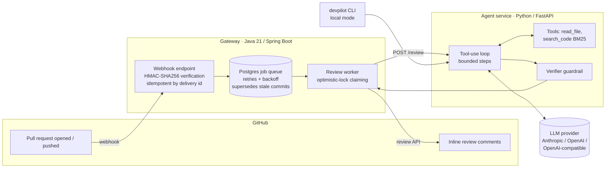

# DevPilot: AI Code Review Agent

DevPilot is an LLM agent that reviews code changes like a senior engineer. It reads the diff,
**investigates the surrounding code with tools** (file reads, BM25 code search), and reports
specific, line-level problems: bugs, security holes, concurrency issues, broken error handling
and performance traps. Each problem comes with a concrete fix.

It runs two ways:

| Mode | How you use it | Needs GitHub? |
|---|---|---|
| **Local mode** | `devpilot review` in any git repo; results print in your terminal. It can also run as a pre-push hook. | No |
| **GitHub mode** | Open a pull request; DevPilot posts inline review comments on it automatically. | Yes |

Every comment passes through a **verifier guardrail** before you see it. The guardrail removes
hallucinated files, comments on lines the PR didn't touch, low-confidence guesses, duplicates and nits.

---

## Architecture



**Why two services?** The gateway handles the parts that need to be reliable: signature checks,
durable queueing, retries, idempotency and the GitHub API. The agent handles the parts that keep
changing: prompts, tools and model providers. Either one can be deployed or scaled on its own.

### Design decisions

- **Async webhook handling.** A review takes 30–90 seconds with a real LLM, but GitHub times out
  webhooks after 10 seconds. The endpoint therefore only verifies and enqueues the job, then
  returns `202 Accepted`. A worker does the review.
- **The database is the queue.** Jobs survive restarts. Several gateway instances can poll safely
  because a JPA `@Version` optimistic lock decides which instance claims a job. Failed jobs retry
  with exponential backoff up to `max-attempts`, then are marked `FAILED` with the error.
- **Idempotent and supersedes stale work.** Duplicate deliveries (same `X-GitHub-Delivery`) are
  ignored. A new push to a PR marks older queued reviews of that PR `SUPERSEDED`, so no model
  calls are spent on outdated commits.
- **Bounded agent.** The loop is capped at `max_steps`. On the last step only `submit_review` is
  offered, so a review always finishes. Malformed model output is dropped and never crashes a run.
- **Verifier guardrail.** The verifier applies hard rules after the model, and each dropped
  comment is recorded with its reason:
  - the file must be in the diff
  - the line must be added or modified (near misses within 2 lines are snapped onto the changed line)
  - confidence must meet the threshold
  - nits are filtered, along with duplicates and vague comments
  - at most 12 comments per review, ordered by severity
- **Human stays in charge.** Reviews are posted with `event: COMMENT`. DevPilot never approves
  or blocks a PR.
- **Provider-agnostic.** One internal message format, with adapters for Anthropic and for the
  OpenAI format. Gemini uses Google's OpenAI-compatible endpoint, and Gemini 3 *thought signatures*
  are carried through tool-call turns so multi-step reviews keep working. `OPENAI_BASE_URL` also
  works with Ollama or vLLM for self-hosted models.

---

## Quick start: local mode (no GitHub needed)

**One step:** `bash scripts/setup_and_run.sh` installs everything, runs the tests, asks for your
API key (hidden, never saved) and runs the benchmark. Add `openai` or `gemini` to use those providers. To do it by hand instead:

```bash
cd agent
pip install -e ".[dev]"
export ANTHROPIC_API_KEY=sk-ant-...      # or OPENAI_API_KEY / GEMINI_API_KEY with --provider openai / gemini

cd ~/code/my-project
devpilot review                          # uncommitted changes
devpilot review --staged                 # staged changes only
devpilot review --base main              # your branch vs main
devpilot review --format json            # machine-readable
devpilot review --fail-on critical       # exit 1 on critical issues (for hooks/CI)
```

No API key yet? Add `--provider mock` to run the full pipeline with an offline, rule-based stand-in
(see [Results](#results)).

**Pre-push hook.** This blocks a push when DevPilot finds a critical issue:

```bash
scripts/install-pre-push-hook.sh ~/code/my-project
```

Example output: see [docs/local-mode-output.txt](docs/local-mode-output.txt).

---

## GitHub mode

### 1. Run the services

```bash
cp .env.example .env        # fill in ANTHROPIC_API_KEY, GITHUB_TOKEN, GITHUB_WEBHOOK_SECRET
docker compose up --build   # postgres + agent (:8000) + gateway (:8080)
```

`GITHUB_TOKEN` is a fine-grained personal access token with **Pull requests: Read and write** and
**Contents: Read** on the repos you want reviewed.

### 2. Expose the gateway and add a webhook

For local testing, expose the gateway with a tunnel, e.g. `ngrok http 8080`. Then in your repo, go
to **Settings → Webhooks → Add webhook** and set:

- **Payload URL:** `https://<your-tunnel>/webhooks/github`
- **Content type:** `application/json`
- **Secret:** the same value as `GITHUB_WEBHOOK_SECRET`
- **Events:** *Let me select individual events* → **Pull requests**

Open a PR, and within a minute or two DevPilot posts its review.
`GET http://localhost:8080/api/reviews` shows job status, attempts, timings and errors.

### Try GitHub mode without GitHub

`scripts/e2e_demo.sh` starts a fake GitHub API, the agent and the gateway, sends a **signed**
webhook, and prints the review that gets posted:

```bash
scripts/e2e_demo.sh            # offline (mock provider)
scripts/e2e_demo.sh anthropic  # real LLM, needs ANTHROPIC_API_KEY
```

Recorded output: [docs/e2e-demo-output.txt](docs/e2e-demo-output.txt).

---

## Results

### Tests

| Component | Tests | What they cover |
|---|---|---|
| Agent (pytest) | 24 passing | OpenAI/Gemini adapter against a fake HTTP server (including thought-signature round trip), diff parsing (multi-hunk, new and deleted files), every verifier rule, the tool-use loop feeding results back, step-budget enforcement, role alternation, unknown tools, API endpoints, CLI local mode on a real git repo, eval scoring |
| Gateway (JUnit + MockMvc) | 8 passing | HMAC check against GitHub's documented test vector, bad signature → 401, ping, ignored actions and draft PRs, duplicate deliveries, superseding stale commits, worker posts review to GitHub, retry → permanent failure after 3 attempts, review API |

```bash
cd agent && pytest -q          # 24 passed
cd gateway && mvn test         # Tests run: 8, Failures: 0, Errors: 0
```

### End-to-end run

A signed webhook flows through gateway → queue → worker → agent → verifier → GitHub review API.
The job completed on the first attempt (`status: DONE`), and one inline comment was posted on the
right line of the PR. See [docs/e2e-demo-output.txt](docs/e2e-demo-output.txt).

### Seeded-bug benchmark

[`agent/evals/cases.py`](agent/evals/cases.py) contains 14 realistic PRs:

- 11 with a planted defect: SQL injection, `==` on strings, resource leak, race condition,
  `Optional.get()`, swallowed exception, off-by-one, hard-coded secret, mutable default argument,
  bare `except`, and an N+1 query
- 3 clean PRs that measure false positives

A comment counts as correct if it lands within ±2 lines of the planted bug.

```bash
cd agent
python -m evals.run_eval --provider mock        # offline baseline
python -m evals.run_eval --provider anthropic   # LLM agent (or openai / gemini)
```

Each run writes a Markdown and JSON report to `agent/evals/results/`.

| Reviewer | Precision | Recall | F1 | Clean PRs with false positives |
|---|---|---|---|---|
| Rule-based baseline (`mock`, regex) | 1.000 | 0.273 | 0.429 | 0 / 3 |
| LLM agent (`gemini`, `gemini-3.1-flash-lite`, reasoning effort `minimal`) | 0.769 | 0.909 | 0.833 | 3 / 3 |

Gemini run: one pass over the 14 cases on 2026-11-22. The LLM agent found **10 of 11 planted
bugs** (recall 0.909), compared with 3 of 11 for the regex baseline. It caught the bugs that need
an understanding of the code: the race condition, the off-by-one error, the N+1 query and
`Optional.get()`. It missed the resource leak, where the reader isn't closed if an exception is
thrown. The weak spot is **false positives: it flagged one issue on each of the 3 clean PRs**, so
lowering noise on correct code is the next thing to improve, for example by tuning the verifier's
confidence threshold or adding a self-check step. Latency varied a lot (1–175 s per review)
because the API returned 503s and timeouts during the run, which DevPilot retried automatically.

These numbers come from a single run on a small benchmark, so treat them as indicative. To
reproduce them:

```bash
DEVPILOT_MODEL=gemini-3.1-flash-lite DEVPILOT_REASONING_EFFORT=minimal \
  python -m evals.run_eval --provider gemini
```

---

## Configuration

| Variable | Service | Default | Purpose |
|---|---|---|---|
| `DEVPILOT_PROVIDER` | agent | `anthropic` | `anthropic`, `openai`, `gemini` or `mock` |
| `GEMINI_API_KEY` | agent | none | key from Google AI Studio |
| `DEVPILOT_MODEL` | agent | provider default | model override |
| `DEVPILOT_MAX_STEPS` | agent | `8` | tool-use step budget |
| `DEVPILOT_MIN_CONFIDENCE` | agent | `0.5` | verifier confidence threshold |
| `OPENAI_BASE_URL` | agent | OpenAI | point at Ollama/vLLM for self-hosted models |
| `GITHUB_TOKEN` | both | none | read PRs, post reviews |
| `GITHUB_WEBHOOK_SECRET` | gateway | none | HMAC secret for webhook verification |
| `DATABASE_URL` | gateway | in-memory H2 | Postgres JDBC URL in production |
| `AGENT_URL` | gateway | `http://localhost:8000` | agent service address |

## Project structure

```
agent/                      Python agent service + CLI
  devpilot_agent/
    agent.py                bounded tool-use loop
    tools.py                read_file, search_code, submit_review schemas + executor
    verifier.py             guardrail rules
    diff_parser.py          unified diff -> changed-line map
    repo.py                 InMemory / LocalGit / GitHub repos, BM25 code index
    llm.py                  Anthropic + OpenAI-format adapters (OpenAI, Gemini, Ollama), retries, test double
    mock_provider.py        offline rule-based stand-in
    app.py                  FastAPI: /review, /health, /metrics
    cli.py                  `devpilot review`
  evals/                    seeded-bug benchmark + runner + results
  tests/
gateway/                    Java 21 / Spring Boot 3.5 gateway
  webhook/                  HMAC verification, webhook controller
  review/                   job entity, repository, worker, read API
  client/                   agent + GitHub REST clients
scripts/                    e2e demo, fake GitHub API, pre-push hook installer
docs/                       recorded outputs
.github/workflows/ci.yml    tests + offline eval on every push
docker-compose.yml
```

## Roadmap

- [ ] Cut false positives on clean PRs (currently 3/3 for Gemini Flash-Lite)
- [ ] Run the benchmark against Claude, GPT and larger Gemini models and compare cost and latency per review
- [ ] Embedding-based code search alongside BM25 (hybrid retrieval)
- [ ] Re-review only new commits on `synchronize`, and resolve comments that were fixed
- [ ] GitHub App authentication (installation tokens) instead of a personal access token
- [ ] Run the project's tests in a sandbox as an agent tool
- [ ] Deploy to AWS (ECS Fargate + RDS) with Terraform

## License

MIT
