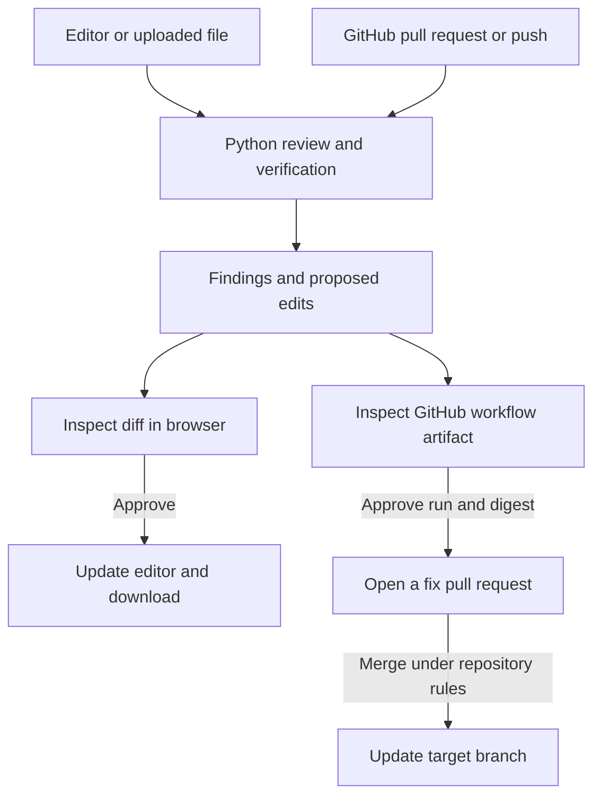

# How DevPilot reviews and applies fixes

A finding, a proposed edit, and an approved change are three separate things. A finding explains a possible bug. A proposed edit shows the exact change a reviewer can inspect. Approval authorizes that particular change against the version that was reviewed.

## From source to findings

The Python review agent sees a diff. A pasted snippet or uploaded text file becomes an in-memory diff that adds the file. A GitHub review starts with the changes in a pull request or push. The agent can read file context and search the repository, then submit findings. The verifier checks that each comment refers to a changed line, removes duplicates and filters low-confidence findings. These checks validate where a finding belongs. A developer still needs to judge whether the finding is correct.

## Browser workspace

1. Paste code or pick a text file. The browser reads a selected file into the editor and sends its text and filename to the review service. With a hosted model provider, the relevant source is included in requests to that provider.
2. Review the findings and proposed diff. The browser keeps the reviewed filename, original contents and proposed replacement together. The API produces a preview without writing to a filesystem.
3. Ask follow-up questions in chat. Chat receives the current source and review context and has no write tools. A reply such as “yes” in the conversation does not apply a change.
4. Approve the preview to replace the editor contents, then download the approved file. Opening another file or editing the source invalidates the pending preview. The original file on disk stays under the user's control.

The browser owns the working copy, so a browser approval can only change that copy. A GitHub write requires its own authorization.

## GitHub reviews and fix proposals

A repository workflow reviews pull requests and pushes. GitHub provides the event and commit identifiers, and DevPilot reads the source at the reviewed version. When a review yields a fix proposal, the workflow publishes the proposed change for inspection. Applying it is a separate workflow run initiated by a maintainer. The apply step checks the proposal and the branch revision before opening a fix pull request. Merging that pull request remains a separate decision under the target repository's rules.

The Spring gateway provides a second way to deliver PR reviews. It verifies signed PR webhooks, queues work and calls the Python agent. Choose a single review entry point per repository to avoid duplicate comments. The Python onboarding endpoint below offers to install the Actions workflow on a new repository.

## Enable reviews for future repositories

An Actions workflow lives inside a repository. A central webhook handles the earlier moment when GitHub creates a repository on your account. The operator chooses which account and installations it may serve.

1. Deploy the Python service at a stable HTTPS address. In your GitHub App settings, use `https://YOUR-HOST/onboarding/github` as the webhook URL, set a strong shared webhook secret, and subscribe to **Repository** and **Push** events. Grant repository **Contents**, **Pull requests**, and **Workflows** read/write permissions. Install it on the intended account. Choose **All repositories** to include future repositories, or explicitly grant access to selected repositories.
2. Set these secrets and variables on the onboarding service. Keep private credentials in the host's secret settings.

   | Variable | Value |
   |---|---|
   | `DEVPILOT_ONBOARDING_OWNER` | One permitted GitHub user or organization login. |
   | `DEVPILOT_ONBOARDING_SECRET` | The same webhook secret configured in GitHub. |
   | `DEVPILOT_ONBOARDING_REF` | Full 40-character commit SHA of a trusted DevPilot release containing the approval workflow and its example. The setup PR copies that example and pins DevPilot actions to this commit. |
   | `DEVPILOT_ONBOARDING_APP_ID` | The App ID from the GitHub App settings. |
   | `DEVPILOT_ONBOARDING_PRIVATE_KEY` | The PEM private key for that App. Both literal line breaks and escaped newlines are accepted. |

   For an organization webhook, configure its content type as `application/json` and subscribe to the same events. Supply a scoped `DEVPILOT_ONBOARDING_TOKEN` with access to the target repositories and workflow, content and pull-request write permissions in place of the two App credentials. The App path issues a short-lived token restricted to the repository in the signed delivery. [GitHub installation token permissions](https://docs.github.com/en/apps/creating-github-apps/authenticating-with-a-github-app/generating-an-installation-access-token-for-a-github-app)

3. On a `repository.created` event, DevPilot checks the default branch. An empty repository returns `waiting_for_default_branch`. The first push to the default branch checks again. For an eligible repository, DevPilot opens **Set up DevPilot code review**, adding the workflow on `devpilot/setup-review`. Forks, archived repositories and disabled repositories are skipped.
4. Inspect the workflow, configure its model provider secret, and merge the setup PR to activate it. Merging the workflow into the default branch triggers a baseline review of existing code. DevPilot scans up to 50 eligible source files within a 50,000-character diff budget and reports coverage. You can rerun it from **Actions → DevPilot review → Run workflow → baseline**. A subsequent webhook delivery finds an installed workflow or the existing setup PR. Closing the setup PR records your decision. To opt in later, reopen it or install the example manually.

Each setup PR changes only the workflow file. If someone already uses the setup branch for different work, the webhook returns `setup_branch_conflict`. For a failed delivery, check the GitHub webhook's **Recent deliveries** and use **Redeliver** after resolving the reported failure. The handler checks for an existing setup PR and can resume if an earlier delivery created its branch but stopped before opening the PR. [GitHub webhook delivery guide](https://docs.github.com/en/webhooks/testing-and-troubleshooting-webhooks/redelivering-webhooks)
